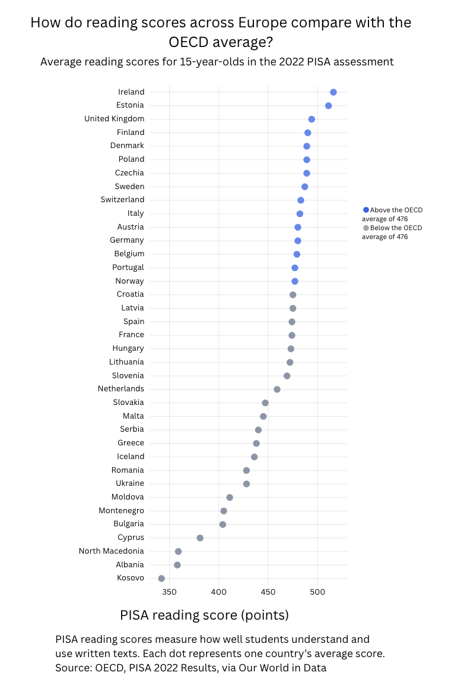
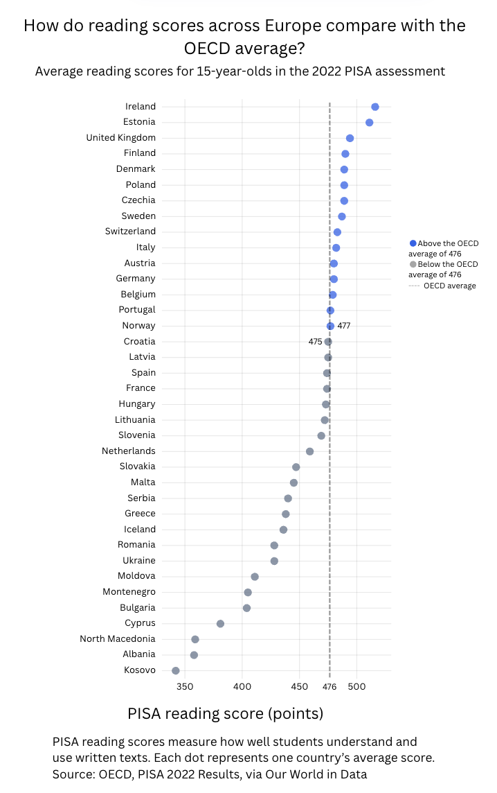

[Home page](./) | [Data viz examples](dataviz-examples) | [Critique by design](critique-by-design) | [Final project I](final-project-part-one) | [Final project II](final-project-part-two) | [Final project III](final-project-part-three)

# Critique by Design: PISA Reading Scores Across Europe

## Step one: The visualization

I chose Our World in Data’s map of average reading scores for 15-year-olds in the 2022 PISA assessment. I focused on the Europe view with both sexes included. I liked that the map gave me a quick sense of the geographic pattern, and the color scale helped me see where scores were generally higher or lower.

Once I wanted to compare specific countries, I had to slow down. Smaller countries were harder for me to spot, and I had to hover over the map or switch to the table to get exact scores. That made me want to design a view around a question I could answer by looking at the chart itself: How do reading scores across Europe compare with the OECD average?

[View the original Our World in Data map](https://ourworldindata.org/grapher/academic-performance?tab=map&region=Europe&subject=reading&sex=both&time=2022)

## Step two: The critique

Using Stephen Few’s Data Visualization Effectiveness Profile, I looked at how well the map supported two tasks: getting a quick overview and comparing individual countries. The map worked well for the overview. For a country-by-country comparison, I had to identify each country on the map, compare its color to the scale, and use a tooltip or table to check the exact value. I also wanted more context for what a reading score like 476 measures.

The critique helped me pinpoint where I was doing extra work as a reader. It also helped me decide what to carry forward. I kept color as a quick visual cue and used a shared numerical axis so readers could compare the scores directly.

I completed and submitted the Data Visualization Effectiveness Profile through the assignment’s Google Form.

## Step three: Sketch a solution

I made a horizontal dot plot in Canva so each country would have its own row and an equally sized dot. I sorted the scores from highest to lowest, which made it easier to find and compare countries. I used blue for scores above the OECD average and gray for scores below it.

In my first wireframe, the legend gave the OECD average of 476 points. I wanted to see whether readers could use the legend and the axis together to tell how close a country was to that average.

*Initial wireframe before feedback.*

## Step four: Test the solution

I shared my initial wireframe with Gemini and asked what it understood from the chart, what was confusing, and what it would change. Gemini was my only source of feedback on the wireframe. It pointed out that readers had to estimate where 476 fell on the axis. It also suggested labeling a few scores near the benchmark.

I realized the color change could make two nearly identical scores look more different than they were. In the revised Canva wireframe, I added a dashed line at 476 and labeled two nearby dots to show how close they were to the benchmark.

*Revised wireframe after Gemini’s feedback.*

## Step five: Build the solution

I rebuilt the dot plot in Tableau using the 2022 PISA reading scores for the 37 European countries shown. I kept the dashed line at the OECD average and labeled Croatia’s 475 on the left and Portugal’s 477 on the right. Their scores are just two points apart, and the labels make that difference easy to see. Readers can hover over any dot to see the country and its exact score.

Ireland and Estonia had the highest scores among the countries shown. Overall, 15 of the 37 countries scored above the OECD average and 22 scored below it. Sorting the dots on a shared scale made it easier to see both the full spread and the small differences near the benchmark.

[Explore the interactive Tableau redesign](https://public.tableau.com/app/profile/aastha.agrawal/viz/PISAReadingScoresAcrossEurope2022/Sheet1)

## References

- [Our World in Data, Academic performance, original map and country scores](https://ourworldindata.org/grapher/academic-performance?tab=map&region=Europe&subject=reading&sex=both&time=2022)
- OECD, *PISA 2022 Results*, via Our World in Data.
- [Stephen Few, *Data Visualization Effectiveness Profile* (2017)](http://www.perceptualedge.com/articles/visual_business_intelligence/data_visualization_effectiveness_profile.pdf)

## AI acknowledgements

I used Gemini to review my Canva wireframe as my source of peer review for this assignment. I used ChatGPT to help organize my write-up and troubleshoot Tableau as I built the final chart.
