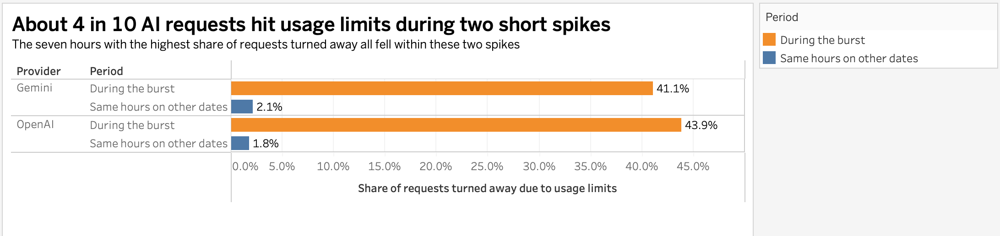
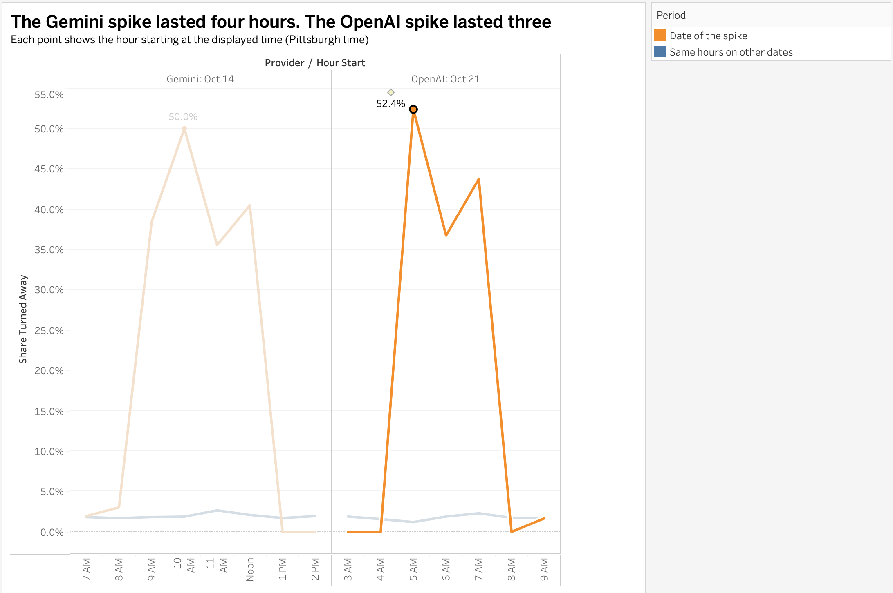
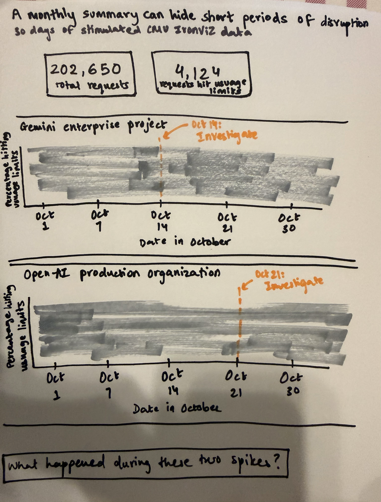

[Home page](./) | [Data viz examples](dataviz-examples) | [Critique by design](critique-by-design) | [Final project I](final-project-part-one) | [Final project II](final-project-part-two) | [Final project III](final-project-part-three)

# When Campus AI Hits Its Limits

## Project outline

### High-level summary

For my final project, I want to explore how brief periods of heavy demand can affect access to campus AI tools. I started investigating this question during CMU’s Student IronViz competition using simulated OpenAI and Gemini request logs. For this class, I plan to build on that work and develop an interactive story for CMU Computing Services staff and campus technology decision-makers.

My main question is, “Where should Computing Services focus its monitoring to keep AI tools reliable as campus use grows?” I want to show how a monthly overview can hide short periods when a much larger share of requests hits a provider limit. I will compare those periods with the same hours on other dates, then explore which provider and account groups were affected. Because the data are synthetic, I will present this as an example of how a university could identify potential access problems and decide where to investigate.

### Intended audience

My primary audience is Computing Services staff and campus leaders who make decisions about AI access and capacity. I want someone without a technical background to understand what a rate limit means, why a short burst matters, and which patterns deserve closer attention.

### One-sentence summary

A low monthly rate of requests hitting provider limits can hide short bursts of disruption, making hourly monitoring useful for identifying where campus AI access needs attention.

### Planned story structure

1. **Start with the campus experience.** Introduce a situation where someone sends a request to an AI tool and receives a message asking them to try again later. Explain that providers limit how many requests or tokens an account can use within a period.

2. **Show the monthly overview.** Introduce the dataset and show the overall number and share of requests that hit a rate limit. Establish what a reader would see if they only looked at a monthly summary.

3. **Zoom into the unusual hours.** Show the share of requests hitting limits over time. Let readers see how particular hours differ from the broader pattern and identify the periods that deserve investigation.

4. **Put the bursts in context.** Compare the selected burst periods with the same hours on other dates for the same provider and account group. This comparison will help readers judge how unusual each burst was.

5. **Identify where monitoring could help.** Show which provider and account groups experienced the selected bursts. End with monitoring priorities and questions for further investigation, such as whether these patterns recur and whether account capacity needs review.

## Initial sketches

I plan to organize the final story as a scrolling page. Each section will introduce one question and place the relevant visualization immediately below it.

### Sketch 1 — The monthly view

This layout compares the percentage of requests that hit usage limits during each spike with the same hours on other dates for the corresponding organization or project. I chose horizontal bars so readers can compare the values directly. Orange highlights the spike periods, while blue represents the comparison periods. Direct percentage labels make the size of the difference clear.

In the final story, this section will introduce the central finding: roughly four in ten requests hit usage limits during the selected spikes, compared with about two in one hundred during the comparison periods.

### Sketch 2 — The hours hidden inside the average

This layout follows the first comparison by showing the hourly pattern surrounding each spike. Separate panels for Gemini and OpenAI allow readers to examine the timing and duration of each event while using the same percentage scale. The orange and blue colors carry the same meaning across both visualizations.

This section will help readers see how quickly the share of requests hitting limits increased and then returned to lower levels. I plan to retain the peak labels and explain that each point represents the hour beginning at the displayed time.

### Sketch 3 — How unusual was each burst?

This proposed opening section will introduce the question, “Where should campus IT teams focus their monitoring?” It will clearly identify the dataset as simulated and display the total number of requests alongside the number that hit usage limits. Below those figures, a timeline covering the full month will show the hourly percentage of requests hitting limits, with separate views for the relevant organizations or projects.

The timeline will highlight the two periods explored in the following sections. Its purpose is to give readers context for why those periods were selected and connect the overall dataset to the detailed comparisons.

## The data

My primary sources are the OpenAI and Gemini telemetry datasets supplied for the Fall 2026 CMU Student IronViz competition. The files contain synthetic API request records covering October 1–30, 2026. There are 108,450 OpenAI records and 94,200 Gemini records, totaling 202,650 requests. The fields include a request identifier, timestamp, model, organization or project identifier, HTTP status code, and token usage stored in a nested JSON field.

For this project, I will use timestamps to group requests by hour and HTTP status codes to identify requests that received a 429 rate-limit response. I will calculate the number of these responses divided by the total number of requests within each period. I will compare providers and account groups separately and use the same hours on other dates as a reference for the selected bursts. I will retain error records because they are central to the access question.

The files contain one timestamp per request, so my analysis will focus on when requests hit limits. They do not provide the request duration or stage timings needed to measure waiting time. The data also do not identify individual users or academic activities, so I will avoid attributing bursts to exams, particular departments, or specific user behavior.

IronViz organizing team confirmed that I may use the datasets for this project and that there are no sharing restrictions. I will acknowledge Student IronViz and label the data as synthetic throughout the project.

### Dataset access

The two datasets used in this project are available below:

- [Dataset 1](https://drive.google.com/file/d/19BlpeZmw1tmELZqJ6Tm9F3_pE355-5qE/view)
- [Dataset 2](https://drive.google.com/file/d/1Tq9YxzoQ-S1XHzWFCK5LqWkKBSRUYHwP/view)

## Method and medium

I plan to build the interactive visualizations in Tableau and publish them to Tableau Public. I will use Shorthand to arrange the charts into a scrolling story with explanatory text and annotations. My GitHub portfolio will document the outline, sketches, data sources, and changes I make as the project develops.

To build on my competition entry, I plan to expand the hourly exploration, make the comparison periods easier to understand, and test the story with readers who have limited experience with AI infrastructure.

## Prior work and acknowledgement

This project builds on my individual submission to CMU’s Fall 2026 Student IronViz competition, “When Campus AI Hits Its Limits.” My professor approved using that work as a foundation and encouraged me to develop it further. I will document the additional analysis, design changes, and audience feedback completed for this class.

## AI acknowledgement

I used ChatGPT to help structure this proposal and discuss which questions the available data could support.
