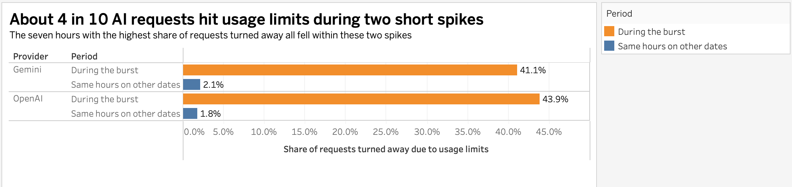
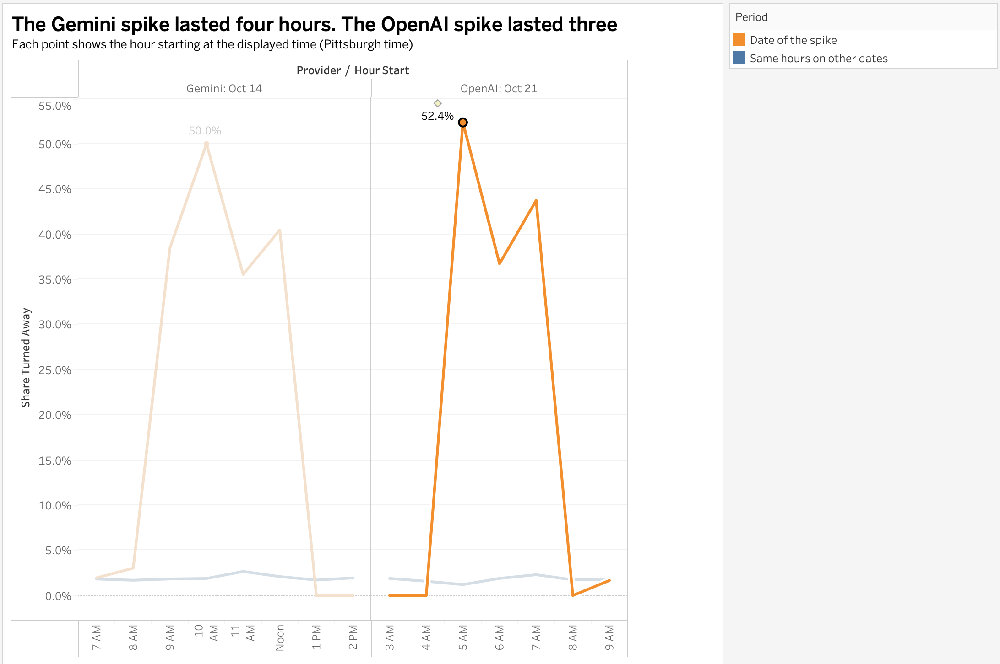
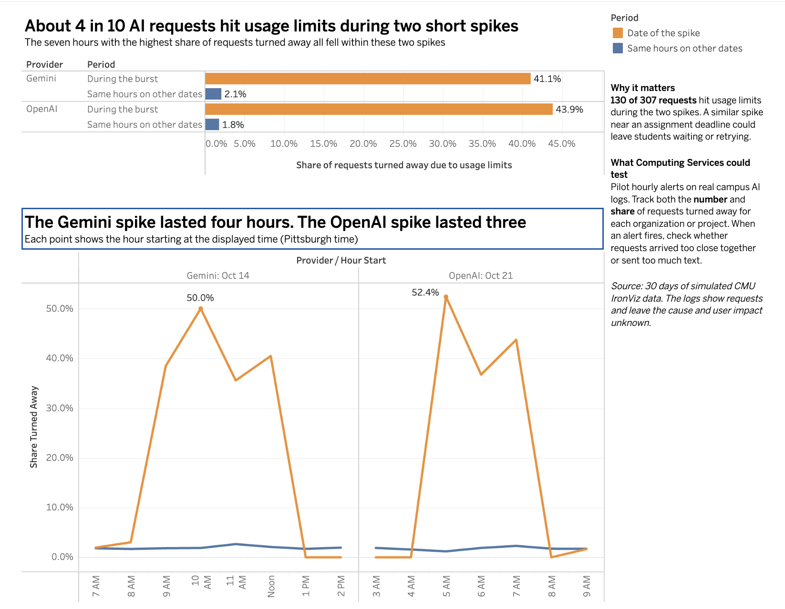

[Home page](./) | [Data viz examples](dataviz-examples) | [Critique by design](critique-by-design) | [Final project I](final-project-part-one) | [Final project II](final-project-part-two) | [Final project III](final-project-part-three)

# Final Project Part II: When Campus AI Hits Its Limits

## Project direction

**Central question: Where should CMU Computing Services focus its monitoring to help keep campus AI tools reliable?**

This project examines 30 days of simulated AI request logs supplied for CMU’s IronViz competition. I focus on two short periods when the percentage of requests hitting usage limits was substantially higher than during the same hours on other dates.

My primary audience is CMU Computing Services and campus technology decision-makers. I want readers to understand why a monthly summary can obscure short periods of disruption and how hourly monitoring could help identify where to investigate.

I am building on my individual IronViz submission by developing a guided narrative, clarifying the measurements, and incorporating feedback from two graduate students and one working professional.

## Responding to Part I feedback

The Part I feedback identified an important ambiguity: “during the burst” did not clearly explain what period I was measuring. Readers could assume that the analysis concerned a known competition, deadline, or other campus event.

The observation period is October 1–30, 2026. The two selected periods are:

| Group | Selected period | Duration |
|---|---|---|
| Gemini enterprise project (`prj-ai-enterprise-prod`) | October 14, 9 a.m.–1 p.m. | Four hours |
| OpenAI production organization (`org-prod-core`) | October 21, 5–8 a.m. | Three hours |

All times are Pittsburgh local time. End times are exclusive. The Gemini window includes the hours beginning at 9 a.m., 10 a.m., 11 a.m., and noon. The OpenAI window includes the hours beginning at 5 a.m., 6 a.m., and 7 a.m.

These periods were identified from patterns in the simulated logs. I have not linked them to a known campus activity or established what caused the increases.

In the revised narrative, I explicitly state the dates, hours, and groups. I also distinguish what the request logs show from possible consequences for users.

## Storyboard: how the story unfolds

The story moves through five scenes: a potential user need, the monthly overview, the selected periods, the hourly detail, and the proposed response.

### Scene 1: Establish why an interruption could matter

**Proposed headline: “An interrupted AI request can interrupt the task behind it.”**

The opening will introduce a hypothetical student using an AI tool to work through a coding problem. A request hitting a usage limit could mean pausing, retrying, or finding another way to continue.

This is an illustrative scenario, not an experience recorded in the dataset.

Feedback suggested strengthening this opening with a source about where students use AI and how it supports their work. I plan to investigate that addition for Part III and keep it separate from the simulated request data.

**Transition:** What can request logs reveal about when interruptions become unusually common?

### Scene 2: Establish the monthly scale

**Proposed headline: “About 2% of requests hit limits overall—but that does not describe every hour.”**

The supplied data contains:

| Measure | Value |
|---|---:|
| Total requests | 202,650 |
| Requests hitting usage limits | 4,124 |
| Overall percentage hitting limits | Approximately 2.0% |

I plan to present these as a simple number panel before narrowing the story to individual groups and time windows.

The full-month timeline proposed in Part I remains a planned extension. The comparison bars and hourly charts below are the completed draft visualizations supporting the current story.

**Transition:** Did the monthly percentage conceal periods with substantially higher percentages?

### Scene 3: Compare the selected periods with their baselines

**Chart headline: “About four in ten requests hit usage limits during two selected periods.”**

| Group | Selected period | Same hours on other dates |
|---|---:|---:|
| Gemini enterprise project | 69 of 168 requests: 41.1% | 108 of 5,090 requests: 2.1% |
| OpenAI production organization | 61 of 139 requests: 43.9% | 79 of 4,357 requests: 1.8% |

Each comparison uses the same organization or project and the same hours on other dates. The baseline percentage uses the pooled request counts rather than an unweighted average of daily percentages.

I chose horizontal bars because the main task is comparing percentages. Direct labels provide exact values, while the accompanying counts explain the size of each comparison.

Orange identifies the selected periods and blue identifies the comparison periods. These are two specific examples, not a ranking of the providers’ overall reliability.

**Source:** CMU IronViz simulated request datasets, October 1–30, 2026.

**Transition:** How did the percentages change within these periods?

### Scene 4: Reveal the timing and duration

**Chart headline: “The Gemini increase lasted four hours; the OpenAI increase lasted three.”**

The panels show hourly percentages for the selected dates alongside the comparison periods. Orange represents the selected date; blue represents the same hours on other dates for that group.

Each point represents the hour beginning at the displayed time. For example, 10 a.m. represents requests from 10 a.m. up to, but not including, 11 a.m.

The displayed hourly percentages reached 50.0% in the Gemini example and 52.4% in the OpenAI example. The line charts show the rise and return to lower percentages, adding detail that the period-level bars cannot communicate.

I chose separate panels with a consistent percentage scale to keep the groups distinct while making their patterns readable.

**Source:** CMU IronViz simulated request datasets. All times are Pittsburgh local time.

**Transition:** What should Computing Services do with this kind of signal?

### Scene 5: Recommend a concrete investigation process

**Closing headline: “Use hourly monitoring to identify where to investigate.”**

My proposed action is for Computing Services to pilot hourly monitoring on real campus AI logs.

For each organization or project, the monitoring would track:

- Total requests.
- Requests hitting usage limits.
- The percentage of requests hitting usage limits.
- Changes relative to the group’s usual pattern at similar times.

Unusual increases would identify a group and time window for investigation. Defining alert thresholds would require testing on real logs.

The simulated examples support exploring this monitoring approach. They do not establish the cause of the limits or a particular technical fix.

## Current interactive prototype

I combined the comparison bars and hourly line charts into a Tableau dashboard. The dashboard includes explanatory text, a proposed monitoring response, and a statement about the simulated data.

[Explore the interactive Tableau prototype](https://public.tableau.com/app/profile/aastha.agrawal/viz/WhenCampusAIHitsItsLimits/Dashboard1)

The dashboard is my current working prototype. The storyboard above explains how I intend to present its evidence within a guided narrative.

## User research: approach

### Purpose

I sought feedback on how clearly the project communicated its story, why the findings mattered, and what readers should do with the information.

### Audience and participant selection

My primary audience is Computing Services and campus technology decision-makers. Students are a secondary audience because they may use the tools and can help assess whether the explanation is understandable and relevant.

I spoke with two graduate students and one working professional. Their feedback offered perspectives on the student context, the call to action, and the presentation of the evidence.

These participants do not establish that the recommendation meets the operational needs of Computing Services. Feedback from someone responsible for campus AI systems would strengthen a later round of research.

### How the conversations were conducted

The initial feedback came from informal conversations about the project at different stages. I did not use a standardized interview script.

The working professional reviewed the earlier bar-chart version. The graduate students provided feedback about the story’s opening and its proposed call to action.

The findings below document the feedback I received rather than reconstructing answers to questions I did not ask. They are paraphrases, not direct quotations. Names and identifying details are omitted.

## Findings from three participants

### Participant 1: Graduate student — reconsidering the call to action

This participant suggested that the project could explain what students could do to avoid hitting usage limits. My existing recommendation focused on helping the campus IT team identify where to investigate.

The suggestion made me reconsider who should act after reading the story. Student guidance could offer immediate practical value, but it would introduce a second audience and require evidence about which actions actually help prevent limits.

**My response:** I am retaining Computing Services as the primary audience. The simulated logs do not establish whether particular student behaviors caused the limits or what students could have done to prevent them.

Although I am not adopting the suggestion directly, it showed me that the closing section needs to identify its intended audience and action more clearly.

### Participant 2: Graduate student — establishing why readers should care

This participant suggested opening with information about where students use AI and how it helps them. They proposed another dataset to provide that context before introducing the spikes.

This helped me recognize that my initial story moved quickly into request failures without establishing the activities those requests might support.

**My response:** I plan to look for a credible source or dataset about student uses of AI and use a focused finding to strengthen the opening. Any contextual evidence will be distinguished from the simulated IronViz logs.

This addition remains planned. I will not imply that the logs identify students’ tasks or demonstrate that a particular assignment was interrupted.

### Participant 3: Working professional — explaining the timing

The working professional reviewed the earlier bar chart and suggested showing the specific hours of the spikes. They mentioned a scatter plot or another view that could reveal the timing.

The bar chart communicated the difference between the selected periods and the comparison periods, but it did not reveal how the percentages changed within those windows.

**Change implemented:** I added hourly line charts and combined them with the comparison bars in the Tableau dashboard.

I chose line charts because the observations follow consecutive hours. This addressed the request for timing detail while preserving the bar chart’s clear period-level comparison.

## Synthesis: what I learned

The conversations identified three different needs:

| Participant | Main issue raised |
|---|---|
| Graduate student 1 | Clarify what readers can do with the information. |
| Graduate student 2 | Explain why the information matters in a student context. |
| Working professional | Show when the increases occurred in more detail. |

Together, the comments pointed toward a stronger connection between context, evidence, and action.

The proposed directions also differed. Student prevention advice would shift the project toward individual behavior, while my current recommendation concerns institutional monitoring. I am retaining the operational focus while using student context to explain the stakes.

The participants reviewed the work at different stages. Their comments therefore represent complementary perspectives rather than agreement about the final dashboard.

## Revisions and design decisions

| Feedback or issue | Response | Status |
|---|---|---|
| Show the specific hours of the spikes. | Added hourly line charts alongside the comparison bars. | Implemented in Tableau. |
| Establish why interruptions could matter to students. | Develop an opening using relevant contextual evidence. | Planned for Part III. |
| Consider prevention advice for students. | Retain Computing Services as the primary audience; avoid advice unsupported by the logs. | Direction selected. |
| Clarify “during the burst,” as requested in Part I. | State the exact dates, hours, groups, and comparison method in the narrative. | Implemented in this write-up; chart wording will be checked for consistency. |
| Make the recommendation concrete. | Explain the counts, percentages, and comparisons that hourly monitoring would track. | Developed in the revised closing section. |

## Structured protocol for follow-up testing

The following protocol was developed after the initial conversations. It will guide testing of the revised story; it was not the script used for the feedback documented above.

### Research questions

- Can readers identify the central finding?
- Do they understand the dates, hours, and baseline comparison?
- Can they distinguish simulated request outcomes from possible user consequences?
- Is Computing Services clearly identified as the audience for the recommendation?
- Does the opening provide enough context to make the analysis meaningful?

### Recruitment approach

I plan to seek a participant familiar with campus technology support, alongside student readers with different levels of technical familiarity.

A technology-support perspective would help assess the usefulness of the recommendation. Student perspectives would help evaluate accessibility and the opening context.

### Introduction

“Thank you for reviewing my draft. This project uses simulated AI request logs to examine periods when requests hit usage limits. I am testing whether the story communicates clearly. Please describe what you notice and anything you find confusing. I will summarize your feedback anonymously.”

### Questions

1. What do you think this story is about?
2. Who do you think it is intended for?
3. What is the main takeaway from the charts?
4. What does a request “hitting a usage limit” mean to you?
5. What dates and time periods do the charts cover?
6. What do the orange and blue marks compare?
7. What does the project establish about user impact, and what remains unknown?
8. What action is recommended, and who should take it?
9. What is confusing or missing?
10. What would make the story more useful?

I will use follow-up prompts such as “What led you to that interpretation?” and “Can you point to the relevant part?”

### Documentation

I will record interpretations, points of confusion, and suggested changes. I will distinguish paraphrased notes from exact quotations and omit identifying information.

This round will test whether the revisions address the issues raised in the initial conversations.

## Data sources and measurement

The analysis uses two simulated datasets supplied for CMU’s IronViz competition:

- [Dataset file 1](https://drive.google.com/file/d/19BlpeZmw1tmELZqJ6Tm9F3_pE355-5qE/view?usp=drive_link)
- [Dataset file 2](https://drive.google.com/file/d/1Tq9YxzoQ-S1XHzWFCK5LqWkKBSRUYHwP/view?usp=drive_link)

The analysis uses request timestamps, provider and organization or project identifiers, and recorded rate-limit responses.

For each period:

**Percentage hitting limits = requests hitting usage limits ÷ total requests × 100.**

Across the two selected periods, 130 of 307 requests hit limits, approximately 42.3%. This combined percentage refers only to those periods, not the full month.

### Interpretation limits

The data is simulated. It does not establish actual CMU student behavior, waiting times, missed deadlines, or causes of the limits.

Requests are not unique people. The 130 requests hitting limits do not mean that 130 users were affected.

The selected dates have not been linked to known campus events, and the selected groups should not be treated as representative of all activity from either provider.

Applying the monitoring approach elsewhere would require examining that campus’s own systems and usage patterns.

## Method and medium

I am using Tableau for the interactive charts and GitHub Pages to document the project’s development. I plan to assemble the final guided narrative in Shorthand with embedded Tableau visualizations.

The narrative will introduce the context, establish the monthly scale, examine the selected periods, and close with the monitoring recommendation.

## Priorities for Part III

1. Find and assess a contextual source about student uses of AI.
2. Develop the opening and monthly number panel.
3. Check that chart labels consistently identify the groups, dates, hours, and comparisons.
4. Assemble the guided narrative in Shorthand.
5. Test the revised version using the follow-up protocol.
6. Refine the recommendation based on that feedback.

## Acknowledgements

This project builds on my individual submission to CMU’s IronViz competition. The organizers supplied the simulated datasets and confirmed that they could be reused and shared publicly. My professor approved using the competition work as the foundation for the class project.

The class project extends that foundation through narrative development, clearer definitions, user feedback, and revisions to the context and recommendation.

## AI acknowledgement

I used ChatGPT to help organize this write-up, summarize the feedback I reported, and draft questions for future testing.

The follow-up questions were developed after my initial feedback conversations. They were not used to conduct those conversations.

## References

- CMU IronViz competition. Supplied simulated AI request datasets, linked above.
- Agrawal, Aastha. [When Campus AI Hits Its Limits: Tableau prototype](https://public.tableau.com/app/profile/aastha.agrawal/viz/WhenCampusAIHitsItsLimits/Dashboard1).
